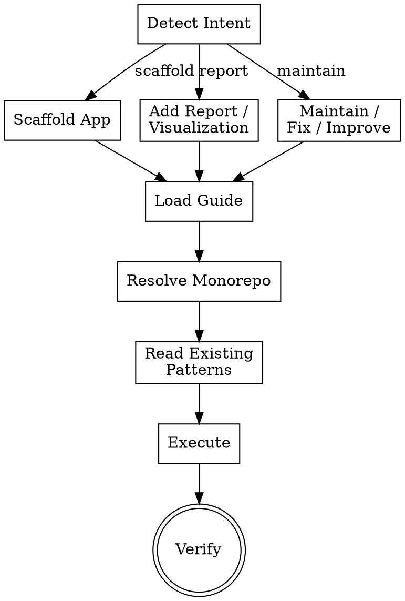

# Build & Maintain OpenLDR Dashboards

Build, scaffold, and maintain dashboard applications in the OpenLDR turborepo monorepo. This skill routes your request to the correct workflow — whether you are creating a new dashboard app from scratch, adding a report or visualization to an existing app, or fixing bugs and improving UX across the monorepo.

**Announce:** "I'm using the openldr:dashboard skill to [scaffold/add report/improve] the dashboard."

## Process



## Phase 1: Resolve Monorepo

The OpenLDR monorepo lives at `../openldr/openldr-monorepo/` relative to this skills repo.

Resolve the absolute path and confirm it exists before proceeding:

```bash
MONOREPO="$(cd "$(dirname "$0")/../../openldr/openldr-monorepo" && pwd)"
```

### Key Paths

| Path | Purpose |
|------|---------|
| `$MONOREPO/apps/` | Dashboard applications (Next.js / React) |
| `$MONOREPO/packages/design_system/` | Shared UI components, tokens, themes |
| `$MONOREPO/packages/auth/` | Authentication logic, session management |
| `$MONOREPO/packages/ai/` | AI/LLM integration utilities |
| `$MONOREPO/packages/utilities/` | Shared helpers, formatters, constants |
| `$MONOREPO/turbo.json` | Turborepo pipeline configuration |
| `$MONOREPO/package.json` | Root workspace configuration |

<HARD-GATE>
If the monorepo path does not exist or is not a valid turborepo workspace, STOP and ask the user for the correct path. Do not guess.
</HARD-GATE>

## Phase 2: Detect Intent

Match the user's request to a workflow using keyword detection:

| Keywords | Intent | Guide |
|----------|--------|-------|
| scaffold, create dashboard, new dashboard, new app, init app, bootstrap | **Scaffold** | `references/scaffold-guide.md` |
| add report, add chart, add visualization, add page, new report, new page, add component | **Report** | `references/report-guide.md` |
| fix, bug, improve, refactor, update, maintain, upgrade, optimize, UX, performance | **Maintain** | `references/maintenance-guide.md` |

If the intent is ambiguous, ask the user to clarify before proceeding.

## Phase 3: Context Gathering

Before executing, read the relevant context for the detected intent:

### Scaffold Mode
1. Read `$MONOREPO/turbo.json` to understand the pipeline
2. Read `$MONOREPO/package.json` for workspace configuration
3. List existing apps in `$MONOREPO/apps/` to understand naming conventions
4. Read the `package.json` of the most recent app for dependency patterns
5. Read `$MONOREPO/packages/design_system/` exports to know available components

### Report Mode
1. Read the target app's directory structure
2. Read existing report pages or visualization components for patterns
3. Read `$MONOREPO/packages/design_system/` for available chart components
4. Check which data-fetching patterns the app uses (API routes, server actions, etc.)
5. Read any existing dashboard layout or template files

### Maintain Mode
1. Read the file(s) the user referenced or described
2. Read related test files if they exist
3. Check `$MONOREPO/packages/` for shared code that may be affected
4. Read recent git history for the affected files to understand change context
5. Run TypeScript check on the affected app to identify existing errors

## Phase 4: Execute

Load the guide selected in Phase 2 and follow its instructions step by step:

- **Scaffold** — follow `references/scaffold-guide.md` to create a new app under `$MONOREPO/apps/`
- **Report** — follow `references/report-guide.md` to add a report page or visualization component
- **Maintain** — follow `references/maintenance-guide.md` to fix, refactor, or improve existing code

Apply every instruction in the loaded guide. Do not skip steps or improvise alternatives.

## Phase 5: Verify

After execution, confirm the work is correct:

1. **Dev server boots** — run `turbo dev --filter=<app-name>` and confirm no startup errors
2. **TypeScript check** — run `turbo typecheck --filter=<app-name>` and confirm zero errors
3. **Lint passes** — run `turbo lint --filter=<app-name>` if a lint pipeline exists
4. **Build succeeds** — run `turbo build --filter=<app-name>` to confirm production build works
5. **No regressions** — if tests exist, run `turbo test --filter=<app-name>`

<HARD-GATE>
Do not declare the task complete until the dev server boots without errors and TypeScript check passes with zero errors.
</HARD-GATE>

## Scope

| Directory | Role | When to Touch |
|-----------|------|---------------|
| `apps/` | Dashboard applications | **Primary** — always for scaffold, report, and most maintenance |
| `packages/design_system/` | Shared UI components | When adding reusable components or fixing shared UI |
| `packages/auth/` | Authentication | When auth flows need changes |
| `packages/ai/` | AI integration | When adding AI-powered features |
| `packages/utilities/` | Shared helpers | When adding shared formatters, constants, or helpers |
| `turbo.json` | Pipeline config | Rarely — only when adding new pipeline tasks |

<HARD-GATE>
When modifying any file under `packages/`, check downstream impact before committing. Run `turbo build` to confirm no other app in the monorepo breaks. A change to a shared package can silently break multiple apps.
</HARD-GATE>

## Anti-Rationalization

| Temptation | Reality |
|------------|---------|
| "I'll just create the component outside the monorepo" | All dashboard code lives in the monorepo. Use the correct `apps/` or `packages/` path. |
| "I don't need to check the design system for existing components" | Always check `packages/design_system/` first. Duplicating components creates maintenance debt. |
| "I'll skip the TypeScript check since the code looks correct" | Run the check. Type errors caught now prevent runtime crashes later. |
| "I can modify the shared package without checking other apps" | Always run `turbo build` after touching `packages/`. Downstream breakage is silent until it isn't. |
| "The dev server probably works, I don't need to start it" | Start it. Visual confirmation catches layout, routing, and hydration issues that static analysis misses. |
| "I'll use my own styling instead of the design system tokens" | Use the design system. Consistent theming is the whole point of a shared component library. |
