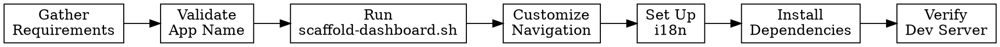

# Scaffold Guide — Create a New Dashboard App

## Purpose

Guide for creating a new dashboard app in the OpenLDR turborepo monorepo. The result is a working Next.js 15 app with auth, theming, AI chat, and navigation.

**Prerequisites:** Monorepo path resolved, user has provided dashboard name and sections.

---

## Process



---

## Step 1: Gather Requirements

Ask the user for the following information before proceeding:

| # | Input | Description | Example |
|---|-------|-------------|---------|
| 1 | **Dashboard name** | Lowercase, kebab-case identifier | `hivvl`, `eid`, `cd4` |
| 2 | **Display title** | Human-readable title (Portuguese) | "Portal de HIV Carga Viral" |
| 3 | **Navigation sections** | Comma-separated section names | "Sumário, Laboratório, Província, Pacientes" |
| 4 | **Primary color** | Hex color code (default `#00B000`) | `#00B000` |
| 5 | **API module path** | API route prefix for this dashboard | `/hiv/vl/`, `/hiv/eid/`, `/tb/gx/` |

<HARD-GATE>
Do not proceed until all five inputs have been collected. If the user omits any, prompt for the missing values explicitly.
</HARD-GATE>

---

## Step 2: Validate App Name

Before running the scaffold script, validate the provided app name:

1. **Format check** — Name must be lowercase and contain only letters, numbers, and hyphens (`^[a-z][a-z0-9-]*$`).
2. **Uniqueness check** — Confirm no directory exists at `$MONOREPO/apps/{app-name}`.

```bash
# Format validation
if [[ ! "$APP_NAME" =~ ^[a-z][a-z0-9-]*$ ]]; then
  echo "ERROR: App name must be lowercase with only letters, numbers, and hyphens."
  exit 1
fi

# Uniqueness validation
if [ -d "$MONOREPO/apps/$APP_NAME" ]; then
  echo "ERROR: App '$APP_NAME' already exists at $MONOREPO/apps/$APP_NAME"
  exit 1
fi
```

<HARD-GATE>
If validation fails, STOP and ask the user for a corrected name. Do not attempt to auto-fix the name.
</HARD-GATE>

---

## Step 3: Run Scaffold Script

Run the scaffold script to generate the app skeleton:

```bash
scripts/scaffold-dashboard.sh {app-name} \
  --sections "{sections}" \
  --monorepo {monorepo_path}
```

**Example:**

```bash
scripts/scaffold-dashboard.sh hivvl \
  --sections "Sumário, Laboratório, Província, Pacientes" \
  --monorepo /home/user/openldr/openldr-monorepo
```

The script creates the full Next.js 15 app structure under `$MONOREPO/apps/{app-name}/` including:

- `package.json` with correct workspace dependencies
- `next.config.ts` with transpile packages
- `tsconfig.json` extending the monorepo base
- `app/` directory with layout, page, and section routes
- Clerk auth middleware
- Design system integration

---

## Step 4: Customize After Scaffold

After the scaffold script completes, apply the following five customizations.

### Step 4a: Dashboard Layout Navigation

Update the dashboard layout file at `$MONOREPO/apps/{app-name}/app/(dashboard)/layout.tsx`:

1. **`navbarOptions`** — Set the navigation items to match the user's requested sections. Each entry needs a `label`, `href`, and `icon`.

2. **`AIChatProvider` dashboard prop** — Set the `dashboard` prop to the app name so the AI chat context is scoped correctly.

3. **`pathToLabel`** — Update the breadcrumb path-to-label mapping to include all section routes.

```tsx
// Example navbarOptions
const navbarOptions = [
  { label: "Sumário", href: "/summary", icon: DashboardIcon },
  { label: "Laboratório", href: "/laboratory", icon: ScienceIcon },
  { label: "Província", href: "/province", icon: MapIcon },
  { label: "Pacientes", href: "/patients", icon: PeopleIcon },
];

// Example AIChatProvider
<AIChatProvider dashboard="hivvl">
  {children}
</AIChatProvider>

// Example pathToLabel
const pathToLabel: Record<string, string> = {
  summary: "Sumário",
  laboratory: "Laboratório",
  province: "Província",
  patients: "Pacientes",
};
```

### Step 4b: Theme Colors

Set the primary color in both theme files:

- `$MONOREPO/apps/{app-name}/theme/dark.ts`
- `$MONOREPO/apps/{app-name}/theme/light.ts`

```ts
// In both dark.ts and light.ts
palette: {
  primary: {
    main: "#00B000", // Replace with user's chosen color
  },
}
```

### Step 4c: Root Layout Metadata

Update `$MONOREPO/apps/{app-name}/app/layout.tsx` with the display title and description in Portuguese:

```tsx
export const metadata: Metadata = {
  title: "Portal de HIV Carga Viral",
  description: "Painel de monitoramento de HIV Carga Viral para o Sistema OpenLDR",
};
```

### Step 4d: Environment Variables

Create `$MONOREPO/apps/{app-name}/.env.local` from the template with the required variables:

```env
# OpenLDR API
OPENLDR_API=https://api.openldr.org

# Clerk Authentication
NEXT_PUBLIC_CLERK_PUBLISHABLE_KEY=pk_test_...
CLERK_SECRET_KEY=sk_test_...
NEXT_PUBLIC_CLERK_SIGN_IN_URL=/sign-in
NEXT_PUBLIC_CLERK_SIGN_UP_URL=/sign-up
NEXT_PUBLIC_CLERK_AFTER_SIGN_IN_URL=/
NEXT_PUBLIC_CLERK_AFTER_SIGN_UP_URL=/
```

Ask the user for their Clerk keys if not already provided. Do not commit `.env.local` to version control.

### Step 4e: i18n Setup

Create the internationalization message files.

**`$MONOREPO/apps/{app-name}/messages/pt.json`** — Full Portuguese translations:

```json
{
  "navigation": {
    "summary": "Sumário",
    "laboratory": "Laboratório",
    "province": "Província",
    "patients": "Pacientes"
  },
  "common": {
    "loading": "Carregando...",
    "error": "Erro ao carregar dados",
    "noData": "Sem dados disponíveis",
    "search": "Pesquisar",
    "filter": "Filtrar",
    "export": "Exportar",
    "refresh": "Atualizar",
    "save": "Salvar",
    "cancel": "Cancelar",
    "confirm": "Confirmar",
    "back": "Voltar",
    "next": "Próximo",
    "previous": "Anterior",
    "close": "Fechar",
    "yes": "Sim",
    "no": "Não",
    "total": "Total",
    "period": "Período",
    "from": "De",
    "to": "Até"
  }
}
```

**`$MONOREPO/apps/{app-name}/messages/en.json`** — English skeleton:

```json
{
  "navigation": {
    "summary": "Summary",
    "laboratory": "Laboratory",
    "province": "Province",
    "patients": "Patients"
  },
  "common": {
    "loading": "Loading...",
    "error": "Error loading data",
    "noData": "No data available",
    "search": "Search",
    "filter": "Filter",
    "export": "Export",
    "refresh": "Refresh",
    "save": "Save",
    "cancel": "Cancel",
    "confirm": "Confirm",
    "back": "Back",
    "next": "Next",
    "previous": "Previous",
    "close": "Close",
    "yes": "Yes",
    "no": "No",
    "total": "Total",
    "period": "Period",
    "from": "From",
    "to": "To"
  }
}
```

Adjust the `navigation` keys to match the actual sections the user requested.

---

## Step 5: Install and Verify

### Install Dependencies

```bash
cd $MONOREPO
pnpm install
```

### Start Dev Server

```bash
pnpm dev --filter={app-name}
```

### Expected Verification

Confirm the following work correctly:

- [ ] **Clerk sign-in** — The sign-in page renders and authentication flow works
- [ ] **Empty dashboard shell** — The main layout loads with navigation sidebar and header
- [ ] **Theme toggle** — Light/dark mode toggle switches themes correctly
- [ ] **AI chat panel** — The AI chat panel opens and is scoped to the correct dashboard

<HARD-GATE>
Do not declare the scaffold complete until the dev server boots without errors and all four verification items are confirmed.
</HARD-GATE>

---

## What's Next

Use the report guide (`references/report-guide.md`) to add reports and visualizations to the newly scaffolded dashboard app.
